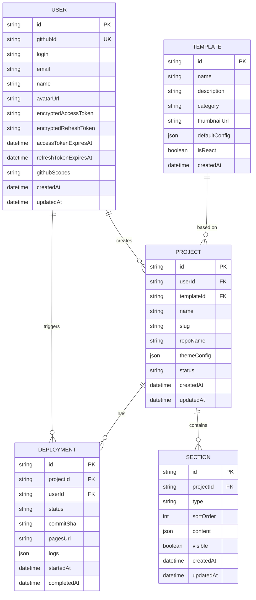

# GitFolio — Architectural Plan

> A planned full-stack SaaS for designing static or React portfolios and publishing them to GitHub Pages through a browser-based workflow.

**Status reviewed: November 18, 2026 (Asia/Manila).** Phases 1–4 are implemented in source, including authentication, project management, and the portfolio editor. Live GitHub consent and production verification remain separate checks. The diagrams and feature contracts below describe the target architecture unless explicitly marked as implemented.

For the product objective, user workflow, benefits, and limitations, read [System Overview](SYSTEM_OVERVIEW.md). For installation commands, read [README.md](README.md).

---

## Table of Contents

- [Implementation Status](#implementation-status)
- [1. Project Overview](#1-project-overview)
- [2. High-Level Architecture](#2-high-level-architecture)
- [3. Technology Stack](#3-technology-stack)
- [4. Monorepo Structure](#4-monorepo-structure)
- [5. Client Architecture](#5-client-architecture)
- [6. Server Architecture](#6-server-architecture)
- [7. Shared Package](#7-shared-package)
- [8. Database Schema](#8-database-schema)
- [9. Authentication & Authorization](#9-authentication--authorization)
- [10. GitHub Integration Pipeline](#10-github-integration-pipeline)
- [11. Background Job Processing](#11-background-job-processing)
- [12. API Contract](#12-api-contract)
- [13. Deployment Flow](#13-deployment-flow)
- [14. Security Architecture](#14-security-architecture)
- [15. Infrastructure & DevOps](#15-infrastructure--devops)
- [16. Development Phases](#16-development-phases)

---

## Implementation Status

These statuses are based on the checked-in source, rather than the presence of a dependency or an empty feature directory.

| Area | Status | Source / evidence |
| --- | --- | --- |
| Monorepo and development commands | Implemented | [Root scripts](package.json), workspace packages, and TypeScript configurations |
| Frontend authentication | Implemented | [Routes](client/src/App.tsx), login/callback/account pages, Zustand auth store, TanStack Query hooks, and [AuthGuard](client/src/components/auth/AuthGuard.tsx) |
| Express foundation | Implemented | [App middleware and health routes](server/src/core/app.ts), [service connections and shutdown](server/src/core/server.ts), [entry point](server/src/index.ts) |
| Environment configuration | Implemented | [Zod environment schema](server/src/config/env.schema.ts), root `.env` loader, and Prisma CLI wrapper |
| Database structure | Schema and initial migration implemented | [Five Prisma models](server/prisma/schema.prisma) and [initial migration](server/prisma/migrations/20261116000000_init/migration.sql); application to a normal development or production database is not established by these files |
| Shared package | Implemented | [Exports](packages/shared/src/index.ts): API/auth/project/template schemas, pagination, theme/section defaults, and deployment statuses |
| GitHub OAuth configuration | Local preparation implemented | [Server-only OAuth configuration](server/src/config/github-oauth.ts), callback validation, secret redaction, [configuration checker](server/scripts/check-github-oauth.mjs), and [registration guide](docs/GITHUB_OAUTH_SETUP.md) |
| GitHub authentication | Code implemented; registration/live consent pending | [Auth module](server/src/modules/auth/auth.module.ts), one-time state/PKCE, JWT verification/revocation, AES-256-GCM, and token refresh; [details](docs/AUTHENTICATION.md) |
| Project management | Implemented | [Project module](server/src/modules/project/project.route.ts), [seeded catalog](server/src/modules/template/template.seed.ts), dashboard, template picker/setup form, and query hooks; [guide](docs/PROJECT_MANAGEMENT.md) |
| Portfolio editor | Implemented | [Editor workspace](client/src/pages/EditorPage.tsx), sections, theme controls, live preview, undo/redo, and debounced revision-checked saves; [guide](docs/PORTFOLIO_EDITOR.md) |
| Publishing | Planned | No GitHub repository/Pages provider, site generator, BullMQ queue, or deployment worker is implemented |
| Production operation | Planned | No production deployment or end-to-end GitHub Pages publishing has been verified |

### Current executable behavior

- `npm run dev` builds the shared package, generates Prisma Client, and starts the shared, server, and client watchers.
- The API connects to both PostgreSQL and Redis before listening. Redis is already a startup dependency; queue processing itself is still planned.
- `GET /api/health` checks the HTTP process. `GET /api/health/ready` queries PostgreSQL and pings Redis, returning HTTP 503 if a dependency check fails. Both routes are under the API rate limiter.
- The frontend processes OAuth callbacks and protects `/account`, `/dashboard`, `/projects/new`, and `/projects/:id/edit` with AuthGuard. Successful sign-in defaults to the dashboard. Vite proxies `/api` to Express for same-origin cookies.
- `/api/projects` implements owner-scoped CRUD and paginated search/filtering. `/api/templates` supplies an authenticated catalog with validated defaults. Four missing templates are seeded at startup; `npm run db:seed` is also available.
- `PATCH /api/projects/:id/editor` atomically saves ordered sections/theme against a base revision. The editor uses an isolated Zustand history, responsive live preview, and 800 ms debounced TanStack Query mutations. Apply the editor-revision migration before using saves.
- `/api/auth/github`, `/api/auth/github/callback`, `/api/auth/me`, and `/api/auth/logout` implement authentication. Missing OAuth credentials or application secrets disable auth safely with HTTP 503.
- `npm run oauth:check` validates local configuration without connecting to PostgreSQL or Redis. It does not verify GitHub-issued credentials or perform sign-in.

### Verification boundaries

Automated tests exist for HTTP behavior, configuration, OAuth callback rules, credential redaction, database relationships, and server lifecycle. Database and full server integration tests require explicitly supplied disposable service URLs and may be skipped during a normal test run. A committed migration, a passing configuration check, and a working live deployment are separate pieces of evidence.

Unit/HTTP tests and browser tests with synthetic API responses validate authentication, project management, and editor behavior. Real database/Redis integrations require explicitly supplied disposable service URLs and are skipped when unavailable. The editor-storage suite verifies concurrent saves and rollback with real Prisma transactions. GitHub consent and production deployment remain separate verification steps.

---

## 1. Project Overview

**GitFolio** aims to let users authenticate with GitHub, design portfolio websites using a visual editor, and publish them to GitHub Pages without terminal commands in the end-user workflow. The planned platform automates repository creation, file commits, and publishing configuration through the GitHub API. Generated source will live in the user's repository, giving the user control over that output subject to applicable template and asset licenses.

Developers and operators still need environment, database, Redis, and OAuth setup. The product's browser-only publishing objective does not remove those development and operating tasks.

### Core Value Propositions

| Value                  | Description                                                                 |
|------------------------|-----------------------------------------------------------------------------|
| **Zero-CLI Deployment**| Target end-user workflow automates repository and publishing steps through the API |
| **Code Ownership**     | Generated source lives in the user's repository; editor drafts still depend on GitFolio's database |
| **Low Hosting Cost**   | Eligible public portfolios can use GitHub Pages on GitHub Free; platform infrastructure has separate costs |
| **Visual Editing**     | Drag-and-drop or form-based editor for building portfolios                 |
| **Template System**    | Pre-built, customizable templates to accelerate portfolio creation         |

GitHub Pages serves static websites and has plan, usage, and content restrictions. GitFolio's Express API, worker, PostgreSQL, and Redis require their own hosting. See [What is GitHub Pages?](https://docs.github.com/en/pages/getting-started-with-github-pages/what-is-github-pages) and [GitHub Pages limits](https://docs.github.com/en/pages/getting-started-with-github-pages/github-pages-limits).

---

## 2. High-Level Architecture

**Planned product architecture.** The foundation, authentication, templates, project management, and portfolio editor are implemented. The deployment pipeline shown here remains future work.

```
┌───────────────────────────────────────────────────────────────────┐
│                         CLIENT (Browser)                         │
│                                                                  │
│   React + Vite + TailwindCSS + Zustand + TanStack Query          │
│   ┌──────────┐  ┌──────────┐  ┌──────────┐  ┌──────────┐        │
│   │   Auth   │  │  Editor  │  │  Deploy  │  │ Dashboard│        │
│   └────┬─────┘  └────┬─────┘  └────┬─────┘  └────┬─────┘        │
│        └──────────────┴──────────────┴──────────────┘             │
│                          │  REST API (Axios)                     │
└──────────────────────────┼───────────────────────────────────────┘
                           │  HTTPS
┌──────────────────────────┼───────────────────────────────────────┐
│                      SERVER (Express)                            │
│                          │                                       │
│   ┌──────────────────────▼──────────────────────────┐            │
│   │              API Router / Middleware             │            │
│   │   (Helmet · CORS · Rate-Limit · JWT Auth)       │            │
│   └──────────────────────┬──────────────────────────┘            │
│                          │                                       │
│   ┌──────┐ ┌──────┐ ┌───────┐ ┌──────────┐ ┌──────┐            │
│   │ Auth │ │ User │ │Project│ │ Template │ │Deploy│            │
│   │Module│ │Module│ │Module │ │  Module  │ │Module│            │
│   └──┬───┘ └──┬───┘ └───┬───┘ └────┬─────┘ └──┬───┘            │
│      └────────┴─────────┴──────────┴───────────┘                 │
│                          │                                       │
│            ┌─────────────┼────────────────┐                      │
│            ▼             ▼                ▼                      │
│     ┌───────────┐  ┌──────────┐  ┌──────────────┐               │
│     │ PostgreSQL│  │  Redis   │  │  GitHub API   │               │
│     │ (Prisma)  │  │ (BullMQ) │  │  (Octokit)   │               │
│     └───────────┘  └──────────┘  └──────────────┘               │
└──────────────────────────────────────────────────────────────────┘
```

### Planned Data Flow Summary

1. **User** authenticates via GitHub OAuth → receives JWT
2. **User** creates/edits a portfolio project in the visual editor
3. **User** triggers deploy → server enqueues a **BullMQ** job
4. **Worker** picks up the job → uses **Octokit** to:
   - Create / update the GitHub repository
   - Commit generated portfolio files
   - Enable GitHub Pages via the API
5. **GitHub Pages** builds and serves the portfolio at `<user>.github.io/<repo>`

---

## 3. Technology Stack

Versions below follow this repository's package manifests. A declared dependency describes the chosen tool, not a completed integration. PostgreSQL 16 and Redis 7 are the images configured in Compose; an external database connection is an environment choice.

### Client

| Technology           | Purpose                                    |
|----------------------|--------------------------------------------|
| **React 18**         | UI component framework                     |
| **Vite 5**           | Build tool & dev server (HMR)              |
| **TypeScript 5**     | Type safety                                |
| **TailwindCSS 3**    | Utility-first CSS framework                |
| **Zustand 5**        | Lightweight global state management        |
| **TanStack Query 5** | Server-state caching, mutations, sync      |
| **React Router 6**   | Client-side routing                        |
| **Framer Motion 11** | Page transitions & micro-animations        |
| **Axios**            | HTTP client for API communication          |
| **Lucide React**     | Icon library                               |
| **Sonner**           | Toast notification system                  |
| **clsx**             | Conditional className utility              |

### Server

| Technology              | Purpose                                  |
|-------------------------|------------------------------------------|
| **Express 4**           | HTTP framework                           |
| **TypeScript 5**        | Type safety                              |
| **Prisma 5**            | ORM & database migrations                |
| **PostgreSQL 16**       | Primary relational database              |
| **Redis 7**             | Job queue backend & caching              |
| **BullMQ 5**            | Distributed job queue for deploy tasks   |
| **Octokit (REST) 21**   | GitHub API client                        |
| **JSON Web Tokens**     | Stateless authentication                 |
| **Zod 3**               | Runtime schema validation                |
| **Helmet**              | HTTP security headers                    |
| **express-rate-limit**  | API rate limiting                        |
| **Pino 9**              | Structured JSON logging                  |
| **Mustache**            | Server-side HTML template rendering      |
| **ioredis**             | Redis client for BullMQ                  |

### Shared

| Technology   | Purpose                                        |
|--------------|------------------------------------------------|
| **Zod 3**    | Shared validation schemas (client ↔ server)    |
| **TypeScript**| Shared type definitions                       |

### Infrastructure

| Technology            | Purpose                              |
|-----------------------|--------------------------------------|
| **Docker Compose**    | Local development environment        |
| **PostgreSQL 16 Alpine** | Containerized database            |
| **Redis 7 Alpine**    | Containerized queue/cache            |
| **npm workspaces**    | Monorepo package management          |
| **Nodemon**           | Server auto-reload in development    |
| **Concurrently**      | Parallel dev server execution        |

---

## 4. Monorepo Structure

**Target directory layout.** Feature paths in this tree may be planned or empty. The implementation status table links to the source files that actually exist.

```
gitfolio/
├── package.json              # Root — npm workspaces, shared scripts
├── tsconfig.base.json        # Shared TypeScript configuration
├── docker-compose.yml        # PostgreSQL + Redis for local dev
├── .env.example              # Environment variable template
│
├── client/                   # @gitfolio/client — React SPA
│   ├── src/
│   │   ├── assets/           # Static images, SVGs
│   │   ├── components/       # Reusable UI components
│   │   │   ├── auth/         # Login, OAuth callback
│   │   │   ├── editor/       # Portfolio visual editor
│   │   │   ├── deploy/       # Deploy status, progress
│   │   │   ├── layout/       # Navbar, sidebar, footer
│   │   │   └── ui/           # Buttons, modals, inputs
│   │   ├── config/           # App configuration constants
│   │   ├── hooks/            # Custom React hooks
│   │   ├── lib/              # Utility libraries (axios instance, etc.)
│   │   ├── models/           # TypeScript interfaces / types
│   │   ├── pages/            # Route-level page components
│   │   ├── services/         # API service functions
│   │   └── stores/           # Zustand state stores
│   ├── vite.config.ts
│   ├── tailwind.config.ts
│   └── package.json
│
├── server/                   # @gitfolio/server — Express API
│   ├── src/
│   │   ├── config/           # Environment, DB, Redis config
│   │   ├── core/             # App bootstrap, Express setup
│   │   ├── middleware/       # Auth guard, error handler, rate-limiter
│   │   ├── modules/          # Feature modules (vertical slices)
│   │   │   ├── auth/         # GitHub OAuth, JWT issuance
│   │   │   ├── user/         # User profile CRUD
│   │   │   ├── project/      # Portfolio project CRUD
│   │   │   ├── template/     # Template listing & retrieval
│   │   │   └── deploy/       # Deploy orchestration & status
│   │   ├── providers/        # External service adapters (Octokit, etc.)
│   │   ├── jobs/             # BullMQ worker definitions
│   │   └── utils/            # Shared helpers, encryption, logger
│   ├── prisma/               # Prisma schema & migrations
│   ├── nodemon.json
│   └── package.json
│
└── packages/
    └── shared/               # @gitfolio/shared — Cross-workspace types & validation
        └── src/
            ├── constants/    # Shared constants (deploy statuses, limits, etc.)
            ├── types/        # Shared TypeScript type definitions
            └── validation/   # Zod schemas used by both client & server
```

---

## 5. Client Architecture

The login, callback, account, dashboard, template picker/setup form, auth store, feature query hooks, and AuthGuard are implemented. The frontend development server is pinned to port 5173. Editor and deployment screens remain planned.

### 5.1 Routing

| Route                        | Page               | Description                          |
|------------------------------|---------------------|--------------------------------------|
| `/` and `/login`             | Login               | GitHub sign-in, implemented          |
| `/auth/callback`             | OAuth Callback      | Handles GitHub OAuth redirect        |
| `/dashboard`                 | Dashboard           | Implemented owner list, search/filter/pagination, metadata editing, archive/restore/delete |
| `/projects/new`              | New Project         | Implemented template selection and validated project setup |
| `/projects/:id/edit`         | Editor              | Visual portfolio editor              |
| `/projects/:id/deploy`       | Deploy              | Deploy trigger & status tracking     |
| `/projects/:id/settings`     | Project Settings    | Repo name, custom domain, etc.       |
| `/account`                   | Account             | Protected connected profile and logout; preferences remain planned |

### 5.2 State Management Strategy

```
┌──────────────────────────────────────────────┐
│                State Layers                  │
├──────────────────────────────────────────────┤
│                                              │
│  Server State (TanStack Query)               │
│  ├─ Projects list / detail                   │
│  ├─ Templates catalog                        │
│  ├─ Deploy status polling                    │
│  └─ User profile                             │
│                                              │
│  Client State (Zustand)                      │
│  ├─ Auth store (user/status; JWT in cookie) │
│  ├─ Editor store (unsaved changes, canvas)   │
│  └─ UI store (modals, toasts, sidebar)       │
│                                              │
│  Local State (React useState/useReducer)     │
│  └─ Form inputs, toggles, ephemeral UI      │
│                                              │
└──────────────────────────────────────────────┘
```

### 5.3 Component Architecture

Components follow a layered pattern:

- **`ui/`** — Primitives: `Button`, `Input`, `Modal`, `Card`, `Badge`, `Spinner`
- **`layout/`** — Structural: `Navbar`, `Sidebar`, `PageShell`, `Footer`
- **`auth/`** — Domain: `LoginButton`, `OAuthCallback`, `AuthGuard`
- **`editor/`** — Domain: `EditorCanvas`, `SectionPanel`, `ThemePicker`, `PreviewPane`
- **`deploy/`** — Domain: `DeployButton`, `DeployProgress`, `DeployLog`

### 5.4 API Service Layer

```typescript
// services/api.ts — validated same-origin apiFetch() wrapper
// services/auth.service.ts — getSession(), completeOAuth(), logout()
// services/project.service.ts — getProjects(), createProject(), updateProject()
// services/template.service.ts — getTemplates(), getTemplateById()
// services/deploy.service.ts — triggerDeploy(), getDeployStatus()
```

---

## 6. Server Architecture

### 6.1 Module Pattern (Vertical Slices)

The implemented auth module uses controller → service → repository boundaries. Future feature modules under `server/src/modules/` follow the same structure:

```
modules/<feature>/
├── <feature>.controller.ts    # Express route handlers
├── <feature>.service.ts       # Business logic
├── <feature>.repository.ts    # Prisma data access
├── <feature>.routes.ts        # Express Router definition
├── <feature>.schema.ts        # Zod request/response validation
└── <feature>.types.ts         # Module-specific TypeScript types
```

### 6.2 Module Breakdown

Authentication, project CRUD, and the template catalog are implemented. Editing content, revision tracking, user profile updates, and deployment remain planned.

#### Auth Module
- **OAuth Flow**: Redirect → GitHub → Callback → Token exchange
- **JWT Issuance**: HS256 with user/session identifiers, issuer, audience, and timestamps; no GitHub tokens or private profile data
- **Token Refresh**: Handle expiring GitHub access tokens and refresh-token rotation when issued; define application JWT/session refresh separately
- **Session Management**: JWT in an HttpOnly cookie, with Redis-backed revocation and expiry

#### User Module
- **Profile CRUD**: Read/update GitHub-sourced profile data
- **Settings**: Notification preferences, default deploy options
- **Token Storage**: Auth module encrypts access/refresh tokens and private name/email fields with AES-256-GCM

#### Project Module
- **CRUD Operations**: Create, read, update, delete portfolio projects
- **Portfolio Data Model**: Sections, theme, metadata, content blocks
- **Versioning**: Planned revision tracking; the current Prisma schema has no project revision or snapshot model

#### Template Module
- **Template Catalog**: Serve pre-built portfolio templates
- **Template Previews**: Category-based React/CSS previews in the picker and dashboard; generated-site previews remain planned
- **Customization Schema**: Define which parts of a template are editable

#### Deploy Module
- **Deploy Orchestration**: Validate → enqueue → track → report
- **Status Tracking**: `PENDING → BUILDING → PUSHING → DEPLOYING → LIVE → FAILED`
- **Deployment History**: Log all deployments with timestamps and outcomes

### 6.3 Implemented Middleware Stack

```
Request
  │
  ├─ requestLogger()             # Generated request ID and safe request metadata
  ├─ helmet()                    # Security headers; x-powered-by is disabled
  ├─ cors()                      # Allow CLIENT_URL; requests without Origin also pass
  ├─ apiLimiter()                # /api only; default 100 requests/IP/minute
  ├─ express.json()              # JSON body parsing; 1 MB limit
  │
  ▼
Health / Auth Routes → notFound → errorHandler
```

The client receives safe JSON errors instead of internal stack traces. Request logs contain request IDs, method, response status, and duration; URLs, headers, and request bodies are omitted.

Future feature routes must add server-side JWT verification, ownership checks, and Zod request validation before invoking the controller → service → repository flow. CORS is a browser-origin policy and does not authenticate callers.

### 6.4 Providers (External Services)

The OAuth provider [github.ts](server/src/providers/github.ts) handles code exchange, refresh, and profile reads. Repository/Pages and queue provider files below remain planned. Database and Redis clients are created in [database.ts](server/src/config/database.ts) and [redis.ts](server/src/config/redis.ts); lifecycle handling lives in [server.ts](server/src/core/server.ts).

```
providers/
├── github.provider.ts          # Octokit wrapper — repo ops, commits, Pages API
├── redis.provider.ts           # ioredis connection singleton
└── queue.provider.ts           # BullMQ queue/worker factory
```

---

## 7. Shared Package

`@gitfolio/shared` is a buildable ESM workspace package. Its current source contains:

```
packages/shared/src/
├── index.ts                    # Public package exports
├── constants/deploy-status.ts  # Status tuple and DeployStatus type
├── types/api.types.ts          # ApiResponse<T> success/error envelope
├── validation/api.schema.ts       # ApiErrorSchema and HealthResponseSchema
├── validation/auth.schema.ts      # Auth user/session and OAuth callback schemas
├── validation/template.schema.ts  # Template defaults, pagination, theme/section shapes
└── validation/project.schema.ts   # Create/update/query and project response DTOs
```

Auth, project, and template schemas and pagination contracts are implemented. Deployment payload schemas remain planned. Shared browser validation complements server validation; it does not replace server enforcement.

---

## 8. Database Schema

**Implemented schema:** [schema.prisma](server/prisma/schema.prisma), [initial migration](server/prisma/migrations/20261116000000_init/migration.sql), [token lifecycle migration](server/prisma/migrations/20261117000000_github_token_lifecycle/migration.sql), and [editor revision migration](server/prisma/migrations/20261118000000_editor_revision/migration.sql). Auth encrypts private account fields before writing; schema files alone do not prove that a live database has been migrated. Phase 3 uses existing tables; Phase 4 adds the project's optimistic-concurrency counter, not a persistent version-history table.

### Entity Relationship Diagram



### Key Design Decisions

- **Credential ciphertext**: The auth service encrypts access/refresh tokens and private name/email fields with AES-256-GCM. The Phase 2 migration adds refresh-token ciphertext, access/refresh expiration dates, and granted scopes.
- **`json` fields**: `themeConfig`, `content`, and `logs` use PostgreSQL's JSONB for flexible schemas
- **`slug`**: URL-safe project identifier derived from project name
- **`repoName`**: Target GitHub repository name (e.g., `my-portfolio`)
- **`isReact`**: Differentiates static HTML templates from React-based templates
- **Identifiers and timestamps**: UUID keys and PostgreSQL timezone-aware timestamps are defined in the schema.
- **Project status**: `DRAFT`, `PUBLISHED`, and `ARCHIVED` are separate from deployment attempt statuses.
- **Ownership constraint**: A deployment references the composite project key `(id, userId)`, preventing a mismatched deployment owner at the database boundary. Future API services must still authenticate the caller and filter by ownership.
- **Uniqueness and deletion**: Project slugs are unique per user. User/project deletion cascades to dependent records; templates referenced by projects cannot be deleted.
- **Indexes**: Owner/update-time, section ordering, template category, and deployment history/status indexes support the planned access patterns.
- **Remaining storage design**: Project revisions remain planned. Expiring GitHub tokens use PostgreSQL; one-time OAuth state and revocable application sessions use Redis TTLs.

---

## 9. Authentication & Authorization

### Implemented authentication

- Server-only `GITHUB_CLIENT_ID`, `GITHUB_CLIENT_SECRET`, and `GITHUB_CALLBACK_URL` settings; the credentials must be supplied together.
- A callback constrained to the `CLIENT_URL` origin and `/auth/callback` path, without embedded credentials, query parameters, or fragments.
- HTTPS callbacks in production; HTTP callbacks only for local loopback addresses in development/test.
- Vite pinned to port 5173, with `strictPort` enabled to prevent a silent callback-port change.
- Configured sign-in scopes: `read:user` and `user:email`. Repository/workflow access is deferred to the deployment feature.
- A credential-safe `npm run oauth:check` command and [GitHub registration instructions](docs/GITHUB_OAUTH_SETUP.md). OAuth client secrets are redacted by the structured logger.

The auth module, callback component, JWT middleware, encryption service, token lifecycle handling, browser auth store, and AuthGuard are implemented. OAuth App registration, real token exchange, and consent remain pending. See [Authentication](docs/AUTHENTICATION.md) for exact API and storage behavior.

### OAuth Flow

The backend verifies browser-bound, one-time Redis state and S256 PKCE, exchanges codes server-side, revalidates GitHub identity, and issues an application JWT cookie. Expiring GitHub tokens are refreshed under a database row lock. See [GitHub's OAuth flow](https://docs.github.com/en/apps/oauth-apps/building-oauth-apps/authorizing-oauth-apps).

```
┌────────┐         ┌──────────┐         ┌──────────┐
│ Client │         │  Server  │         │  GitHub  │
└───┬────┘         └────┬─────┘         └────┬─────┘
    │                   │                    │
    │  1. Click Login   │                    │
    ├──────────────────►│                    │
    │                   │                    │
    │  2. Redirect to   │                    │
    │◄──────────────────┤                    │
    │  GitHub OAuth URL │                    │
    │                   │                    │
    │  3. User authorizes on GitHub          │
    ├────────────────────────────────────────►│
    │                   │                    │
    │  4. Redirect back with code            │
    │◄───────────────────────────────────────┤
    │                   │                    │
    │  5. POST callback with code/state     │
    ├──────────────────►│                    │
    │                   │  6. Exchange code   │
    │                   ├───────────────────►│
    │                   │  7. Access token    │
    │                   │◄───────────────────┤
    │                   │                    │
    │                   │  8. Fetch user info │
    │                   ├───────────────────►│
    │                   │  9. User data       │
    │                   │◄───────────────────┤
    │                   │                    │
    │  10. JWT + user   │  Upsert user in DB │
    │◄──────────────────┤  Encrypt & store   │
    │                   │  access token      │
    │  11. HttpOnly JWT │                    │
    │  cookie + session │                    │
    └───────────────────┘                    │
```

The exchange endpoint is `POST /api/auth/github/callback`; GitHub's browser redirect goes to the frontend `/auth/callback` route. Code/state parameters are removed from browser history after capture.

### JWT Structure

Issued payload; verification fixes the HS256 algorithm, issuer, audience, and expiration, and checks the Redis session:

```json
{
  "sub": "user-uuid",
  "jti": "session-uuid",
  "iss": "gitfolio",
  "aud": "gitfolio-client",
  "iat": 1700000000,
  "exp": 1700604800
}
```

### Authorization Rules

The auth API restricts profile reads to the JWT's user ID, and logout revokes its Redis session immediately. The resource permissions below describe future feature modules; profile updates are not yet exposed. Public health endpoints do not grant access to user resources.

| Resource        | Owner  | Others | Unauthenticated |
|----------------|--------|--------|-----------------|
| User Profile   | R/W    | —      | —               |
| Project CRUD   | R/W/D  | —      | —               |
| Template List  | R      | R      | R               |
| Deploy Trigger | Owner  | —      | —               |
| Deploy Status  | Owner  | —      | —               |

---

## 10. GitHub Integration Pipeline

**Planned for Phase 5.** No GitHub repository, file commit, workflow, or Pages operation is implemented yet.

### Octokit Operations

The planned `github.provider.ts` will wrap these Octokit capabilities:

| Operation                      | Octokit Method                                 | When Used                     |
|-------------------------------|-----------------------------------------------|-------------------------------|
| Create repository              | `octokit.repos.createForAuthenticatedUser()`  | First deploy                  |
| Check repo exists              | `octokit.repos.get()`                          | Subsequent deploys            |
| Create/update file             | `octokit.repos.createOrUpdateFileContents()`  | Each file in the portfolio    |
| Create tree + commit (batch)   | `octokit.git.createTree()` / `createCommit()` | Bulk file commit              |
| Enable GitHub Pages            | `octokit.repos.createPagesSite()`              | First deploy                  |
| Get Pages deployment status    | `octokit.repos.getPages()`                     | Status polling                |

### Generated Portfolio Structure

```
<user>.github.io/<repo>/
├── index.html              # Main portfolio page
├── styles/
│   └── main.css            # Generated styles
├── scripts/
│   └── main.js             # Optional interactivity
├── assets/
│   └── ...                 # User-uploaded images
└── .github/
    └── workflows/
        └── deploy.yml      # GitHub Actions workflow (if React)
```

For React-based templates, the planned generator will supply a GitHub Actions workflow to build static output for Pages. Generation must account for project-site base paths such as `/<repo>/`; it cannot publish an Express server to Pages.

---

## 11. Background Job Processing

**Planned for Phase 5.** Redis connection/ping support is implemented, and BullMQ is installed. Queue creation, worker registration, retries, and persistent job/status coordination are not implemented.

### BullMQ Architecture

```
┌───────────────┐     ┌───────────┐     ┌────────────────┐
│  Deploy API   │────►│   Redis   │────►│  Deploy Worker │
│  (Producer)   │     │  (Queue)  │     │  (Consumer)    │
└───────────────┘     └───────────┘     └───────┬────────┘
                                                │
                                    ┌───────────┼───────────┐
                                    ▼           ▼           ▼
                              ┌─────────┐ ┌──────────┐ ┌────────┐
                              │ Generate│ │  GitHub  │ │ Update │
                              │  Files  │ │  Push    │ │   DB   │
                              └─────────┘ └──────────┘ └────────┘
```

### Job Lifecycle

```
PENDING  →  BUILDING  →  PUSHING  →  DEPLOYING  →  LIVE
   │            │           │            │            │
   │            │           │            │            └─ Pages URL confirmed
   │            │           │            └─ GitHub Pages enabled
   │            │           └─ Files committed to repo
   │            └─ HTML/CSS/JS generated from project data
   └─ Job enqueued in Redis
```

### Queue Configuration

The following are proposed operating targets, not current settings. Worker timeouts need explicit enforcement during implementation, and retries must avoid duplicate repositories or unsafe repeated writes. Concurrency/backoff must respect GitHub's [API limits](https://docs.github.com/en/rest/using-the-rest-api/rate-limits-for-the-rest-api).

| Setting              | Value              | Rationale                          |
|---------------------|--------------------|------------------------------------|
| **Concurrency**      | 3                  | Respect GitHub API rate limits     |
| **Max Retries**      | 3                  | Handle transient API failures      |
| **Backoff**          | Exponential (2s)   | Avoid hammering on failures        |
| **Job Timeout**      | 120s               | Prevent stuck jobs                 |
| **Remove on Complete** | After 24h        | Keep recent history for debugging  |

---

## 12. API Contract

### Base URL

```
http://127.0.0.1:3001/api
```

### Implemented Endpoints

| Method | Endpoint | Auth | Behavior |
| --- | --- | --- | --- |
| GET | `/health` | No | HTTP liveness; returns `{ success: true, data: { status: "ok" } }` |
| GET | `/health/ready` | No | PostgreSQL query and Redis ping; returns HTTP 503 on a dependency-check failure |

These paths are relative to `/api`. Health and auth responses have `Cache-Control: no-store` and pass through the API limiter. Unknown endpoints return the shared JSON 404 response, except disabled auth groups, which return HTTP 503.

### Feature Endpoints

Auth, project, and template endpoints below are implemented. Deployment and user profile-update contracts remain planned. All project/template routes require authentication; project queries and mutations are owner-scoped.

#### Auth

| Method | Endpoint                         | Auth | Description               |
|--------|----------------------------------|------|---------------------------|
| GET    | `/auth/github`                   | No   | Redirect to GitHub OAuth  |
| POST   | `/auth/github/callback`          | No   | Exchange code for JWT     |
| POST   | `/auth/logout`                   | Yes  | Invalidate session        |
| GET    | `/auth/me`                       | Yes  | Get current user          |

#### Projects

| Method | Endpoint                         | Auth | Description               |
|--------|----------------------------------|------|---------------------------|
| GET    | `/projects`                      | Yes  | List user's projects      |
| GET    | `/projects/:id`                  | Yes  | Get project detail        |
| POST   | `/projects`                      | Yes  | Create new project        |
| PATCH  | `/projects/:id`                  | Yes  | Update project            |
| PATCH  | `/projects/:id/editor`           | Yes  | Save sections/theme with revision check |
| DELETE | `/projects/:id`                  | Yes  | Delete project            |

#### Templates

| Method | Endpoint                         | Auth | Description               |
|--------|----------------------------------|------|---------------------------|
| GET    | `/templates`                     | Yes  | Paginated seeded catalog  |
| GET    | `/templates/:id`                 | Yes  | Get template and defaults |

#### Deployments

| Method | Endpoint                         | Auth | Description               |
|--------|----------------------------------|------|---------------------------|
| POST   | `/projects/:id/deploy`           | Yes  | Trigger deployment        |
| GET    | `/projects/:id/deployments`      | Yes  | List deploy history       |
| GET    | `/deployments/:id/status`        | Yes  | Get deploy status         |

#### User

| Method | Endpoint                         | Auth | Description               |
|--------|----------------------------------|------|---------------------------|
| GET    | `/users/me`                      | Yes  | Get profile               |
| PATCH  | `/users/me`                      | Yes  | Update profile            |

### Standard Response Envelope

The implemented shared contract contains `success` plus `data`, or `success` plus an error's `code` and `message`. Project/template list data contains `items`, `page`, `pageSize`, `total`, and `totalPages`. The optional outer `meta` and validation `details` below remain illustrative future additions.

```typescript
// Success
{
  "success": true,
  "data": T,
  "meta"?: { "page": 1, "limit": 20, "total": 45 }
}

// Error
{
  "success": false,
  "error": {
    "code": "VALIDATION_ERROR",
    "message": "Project name is required",
    "details"?: [...]
  }
}
```

---

## 13. Deployment Flow

**Planned.** The shared status constants and database enum exist; the transitions, worker, GitHub calls, and user-facing progress do not. `LIVE` must only be recorded after the published site is confirmed, and failures must retain actionable, sanitized error information.

### End-to-End Deploy Sequence

```
User clicks "Deploy"
        │
        ▼
┌─────────────────────┐
│  Client validates    │
│  project completeness│
└────────┬────────────┘
         │
         ▼
┌─────────────────────┐
│  POST /deploy        │
│  Server validates    │
│  & enqueues job      │
└────────┬────────────┘
         │
         ▼
┌─────────────────────┐
│  Worker: BUILDING    │──► Render templates with Mustache
│  Generate portfolio  │    or generate React source/workflow
│  files from project  │
│  data + template     │
└────────┬────────────┘
         │
         ▼
┌─────────────────────┐
│  Worker: PUSHING     │──► Octokit: create repo (if new)
│  Commit files to     │    Octokit: create tree + commit
│  GitHub via API      │    Octokit: update ref
└────────┬────────────┘
         │
         ▼
┌─────────────────────┐
│  Worker: DEPLOYING   │──► Octokit: enable Pages
│  Enable GitHub Pages │    Poll for Pages build status
│  & verify build      │
└────────┬────────────┘
         │
         ▼
┌─────────────────────┐
│  LIVE                │──► Update DB with Pages URL
│  Portfolio is live!  │    Notify client via polling
│  https://user.github │
│  .io/repo            │
└─────────────────────┘
```

---

## 14. Security Architecture

### Threat Mitigation

| Concern | Implemented foundation | Required before the relevant feature ships |
| --- | --- | --- |
| **XSS** | Helmet headers and React's normal text escaping | Sanitize generated HTML with `sanitize-html`; validate links and editable content in the editor/generator |
| **OAuth CSRF / code interception** | Browser-bound one-time state, S256 PKCE, server-side code exchange, Origin checks, and HttpOnly cookies | Preserve these controls in future sign-in changes |
| **SQL injection** | Validated auth inputs, Prisma operations, and parameterized tagged SQL for readiness/refresh locks | Validate future feature inputs and use parameterized queries |
| **Token theft** | AES-256-GCM for access/refresh tokens, HttpOnly JWT cookies, Redis revocation, and secret log redaction | Production key management and recovery verification |
| **Request abuse** | API limiter plus a dedicated sign-in limiter | Deploy-specific limits and safe proxy configuration for production |
| **Transport security** | OAuth callback configuration requires HTTPS in production | HTTPS termination and trusted-proxy behavior in the actual production deployment |
| **Ownership** | JWT verification, current-user profile queries, owner-scoped project CRUD, and composite deployment/project ownership foreign key | Ownership-scoped queries on future deployment operations |
| **Operational logging** | Request IDs and safe metadata; URLs, headers, and bodies omitted from request logs | Continue sanitizing feature errors, job logs, and provider responses |
| **Dependencies** | Package manifests/lockfile are present | Dependency review/update automation; existing tracked `node_modules` still need repository cleanup |

### Secrets Management

| Secret                  | Storage               | Notes                                 |
|------------------------|-----------------------|---------------------------------------|
| `JWT_SECRET`           | Environment variable  | Min 32 chars, rotatable               |
| `ENCRYPTION_KEY`       | Environment variable  | 64 hex characters encoding 32 bytes; legacy 32-byte UTF-8 keys supported |
| `GITHUB_CLIENT_SECRET` | Environment variable  | GitHub OAuth App secret               |
| `DATABASE_URL`         | Environment variable  | PostgreSQL connection string          |
| User GitHub Tokens     | PostgreSQL ciphertext | AES-256-GCM with per-user/field associated data |

JWT issuance, verification/revocation, and token encryption/refresh are implemented. Keep credentials out of generated portfolio repositories, frontend bundles, and logs. Preserve encryption keys for database recovery; rotating them requires re-encrypting stored data.

---

## 15. Infrastructure & DevOps

### Local Development

Run from the repository root. Preserve an existing `.env` file; the server and Prisma CLI wrapper both load it.

```powershell
npm install
if (-not (Test-Path .env)) { Copy-Item .env.example .env }
docker compose up -d --wait
npm run db:deploy
npm run dev
```

Before starting Compose, update `POSTGRES_PORT` and the port in `DATABASE_URL` together if 5432 is occupied; likewise for `REDIS_PORT` and `REDIS_URL`. Compose has health checks, persistent volumes, and loopback-only published ports. Applying a migration does not publish a website.

| Service        | URL                       |
|---------------|---------------------------|
| Client (Vite) | `http://localhost:5173`    |
| Server (API)  | `http://127.0.0.1:3001/api` |
| PostgreSQL    | `127.0.0.1:POSTGRES_PORT` (default `5432`) |
| Redis         | `127.0.0.1:REDIS_PORT` (default `6379`) |
| Prisma Studio | `http://localhost:5555`    |

Use `npm run build`, `npm run typecheck`, and `npm test` for the corresponding workspace checks. `npm run oauth:check` validates local OAuth settings without service connections. Full integration tests require explicitly configured disposable service URLs; see [README.md](README.md).

`npm run dev` also watches the shared package. Nodemon builds server TypeScript before executing Node, and shutdown handling drains HTTP requests and disconnects service clients. Shared and server output use ESM imports with `.js` extensions.

### Production Deployment (Planned)

The providers below are candidates, not configured deployments. The platform needs its own frontend/API/worker/database/Redis hosting; Pages is the destination for generated static portfolios. Costs and GitHub's usage terms must be assessed before launch.

```
┌──────────┐     ┌───────────────┐     ┌──────────────┐
│  Vercel  │     │  Railway /    │     │  Managed     │
│  (Client)│     │  Render       │     │  PostgreSQL  │
│          │     │  (Server +    │     │  + Redis     │
│  Static  │────►│   Worker)     │────►│              │
│  SPA     │     │               │     │  (Supabase / │
└──────────┘     └───────────────┘     │   Railway)   │
                                       └──────────────┘
```

---

## 16. Development Phases

### Phase 1 — Foundation *(Implemented)*

- [x] Monorepo scaffolding (npm workspaces)
- [x] Docker Compose for PostgreSQL + Redis
- [x] Base TypeScript configuration
- [x] Client Vite + React setup
- [x] Server Express project structure
- [x] Shared package with Zod
- [x] Prisma schema & initial migration
- [x] Core server bootstrap (Express app, middleware stack)
- [x] Environment config module
- [x] PostgreSQL/Redis startup connections, health/readiness checks, and shutdown handling
- [x] Safe JSON errors, request logging, security headers, CORS, and API limiting
- [x] Shared build/dev watchers and root build/type-check/test/database commands
- [x] Foundation and configuration test suites; optional service integration tests

Phase 1 implementation and local setup commands are documented in [README.md](README.md). Phase 2 adds `/api/auth` routes alongside `/api/health` (liveness) and `/api/health/ready` (PostgreSQL + Redis readiness).

### Phase 2 — Authentication *(Code implemented; GitHub registration pending)*

- [x] Server-only GitHub OAuth configuration, paired credential checks, and callback validation
- [x] Read-only sign-in scopes, a fixed local frontend port, and OAuth client-secret log redaction
- [x] Credential-safe `npm run oauth:check` command and [registration guide](docs/GITHUB_OAUTH_SETUP.md)
- [ ] GitHub OAuth App registration and local credentials — intentionally pending by request; real sign-in remains unverified
- [x] Auth module (controller, service, routes), including one-time state and PKCE
- [x] JWT issuance & verification middleware
- [x] GitHub access token encryption/decryption using AES-256-GCM
- [x] GitHub token expiration, refresh-token rotation, and supporting storage
- [x] Client auth store (Zustand)
- [x] Login page & OAuth callback component
- [x] AuthGuard route wrapper

### Phase 3 — Project Management *(Implemented)*

- [x] Project module CRUD (controller → service → repository)
- [x] Template module (seeded templates)
- [x] Dashboard page (project list, create button)
- [x] New Project page (template picker, setup form)
- [x] TanStack Query hooks for projects & templates

### Phase 4 — Portfolio Editor *(Implemented)*

- [x] Editor page layout (canvas + sidebar panels)
- [x] Section management (add, reorder, remove, edit)
- [x] Theme customization (colors, fonts, spacing)
- [x] Live preview pane
- [x] Auto-save with debounced mutations
- [x] Editor Zustand store for undo/redo

### Phase 5 — Deployment Engine

- [x] BullMQ queue setup & worker registration
- [x] Static site generation (Mustache templates → HTML/CSS/JS)
- [ ] React project generation (with GitHub Actions workflow)
- [ ] GitHub provider: repo creation, tree commit, Pages enablement
- [ ] Deploy status API + client polling
- [ ] Deploy history & logs UI

### Phase 6 — Polish & Launch

- [ ] Error boundaries & fallback UI
- [ ] Toast notifications for async operations
- [ ] Responsive design audit
- [ ] Performance optimization (code splitting, lazy loading)
- [ ] Production deployment configuration
- [x] Baseline README, local setup instructions, and OAuth registration documentation
- [ ] Complete end-user onboarding and production operations/recovery documentation
- [ ] Beta launch
