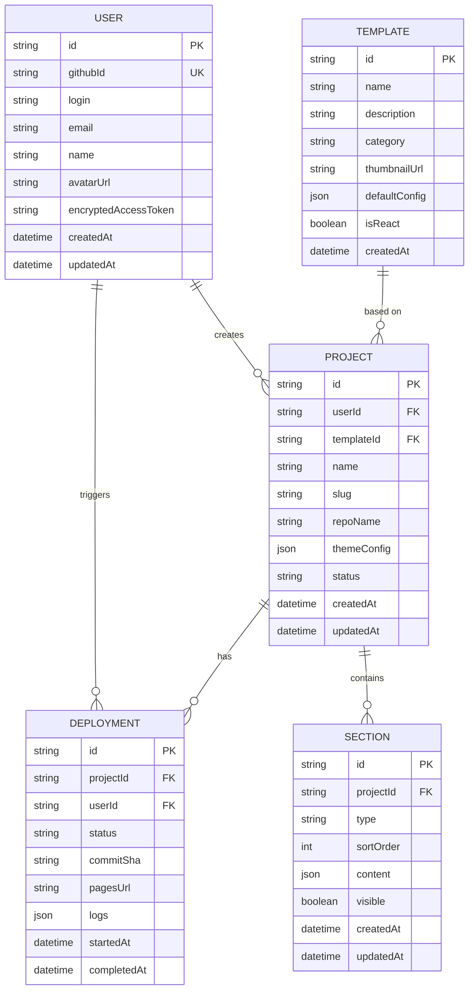

# GitFolio — Architectural Plan

> A full-stack SaaS that lets users design static or React portfolios and deploy them directly to GitHub Pages — with zero terminal commands.

---

## Table of Contents

- [1. Project Overview](#1-project-overview)
- [2. High-Level Architecture](#2-high-level-architecture)
- [3. Technology Stack](#3-technology-stack)
- [4. Monorepo Structure](#4-monorepo-structure)
- [5. Client Architecture](#5-client-architecture)
- [6. Server Architecture](#6-server-architecture)
- [7. Shared Package](#7-shared-package)
- [8. Database Schema](#8-database-schema)
- [9. Authentication & Authorization](#9-authentication--authorization)
- [10. GitHub Integration Pipeline](#10-github-integration-pipeline)
- [11. Background Job Processing](#11-background-job-processing)
- [12. API Contract](#12-api-contract)
- [13. Deployment Flow](#13-deployment-flow)
- [14. Security Architecture](#14-security-architecture)
- [15. Infrastructure & DevOps](#15-infrastructure--devops)
- [16. Development Phases](#16-development-phases)

---

## 1. Project Overview

**GitFolio** is a SaaS platform where users authenticate with GitHub, design portfolio websites using a visual editor, and deploy them to GitHub Pages — all without touching a terminal. The platform automates repository creation, file commits, and CI/CD configuration via the GitHub API (Octokit), ensuring users retain **full code ownership** and benefit from **free hosting**.

### Core Value Propositions

| Value                  | Description                                                                 |
|------------------------|-----------------------------------------------------------------------------|
| **Zero-CLI Deployment**| Users never touch a terminal; all Git operations happen server-side via API |
| **Code Ownership**     | Output lives in the user's own GitHub repo — no vendor lock-in             |
| **Free Hosting**       | Leverages GitHub Pages for $0 hosting costs                                |
| **Visual Editing**     | Drag-and-drop or form-based editor for building portfolios                 |
| **Template System**    | Pre-built, customizable templates to accelerate portfolio creation         |

---

## 2. High-Level Architecture

```
┌───────────────────────────────────────────────────────────────────┐
│                         CLIENT (Browser)                         │
│                                                                  │
│   React + Vite + TailwindCSS + Zustand + TanStack Query          │
│   ┌──────────┐  ┌──────────┐  ┌──────────┐  ┌──────────┐        │
│   │   Auth   │  │  Editor  │  │  Deploy  │  │ Dashboard│        │
│   └────┬─────┘  └────┬─────┘  └────┬─────┘  └────┬─────┘        │
│        └──────────────┴──────────────┴──────────────┘             │
│                          │  REST API (Axios)                     │
└──────────────────────────┼───────────────────────────────────────┘
                           │  HTTPS
┌──────────────────────────┼───────────────────────────────────────┐
│                      SERVER (Express)                            │
│                          │                                       │
│   ┌──────────────────────▼──────────────────────────┐            │
│   │              API Router / Middleware             │            │
│   │   (Helmet · CORS · Rate-Limit · JWT Auth)       │            │
│   └──────────────────────┬──────────────────────────┘            │
│                          │                                       │
│   ┌──────┐ ┌──────┐ ┌───────┐ ┌──────────┐ ┌──────┐            │
│   │ Auth │ │ User │ │Project│ │ Template │ │Deploy│            │
│   │Module│ │Module│ │Module │ │  Module  │ │Module│            │
│   └──┬───┘ └──┬───┘ └───┬───┘ └────┬─────┘ └──┬───┘            │
│      └────────┴─────────┴──────────┴───────────┘                 │
│                          │                                       │
│            ┌─────────────┼────────────────┐                      │
│            ▼             ▼                ▼                      │
│     ┌───────────┐  ┌──────────┐  ┌──────────────┐               │
│     │ PostgreSQL│  │  Redis   │  │  GitHub API   │               │
│     │ (Prisma)  │  │ (BullMQ) │  │  (Octokit)   │               │
│     └───────────┘  └──────────┘  └──────────────┘               │
└──────────────────────────────────────────────────────────────────┘
```

### Data Flow Summary

1. **User** authenticates via GitHub OAuth → receives JWT
2. **User** creates/edits a portfolio project in the visual editor
3. **User** triggers deploy → server enqueues a **BullMQ** job
4. **Worker** picks up the job → uses **Octokit** to:
   - Create / update the GitHub repository
   - Commit generated portfolio files
   - Enable GitHub Pages via the API
5. **GitHub Pages** builds and serves the portfolio at `<user>.github.io/<repo>`

---

## 3. Technology Stack

### Client

| Technology           | Purpose                                    |
|----------------------|--------------------------------------------|
| **React 18**         | UI component framework                     |
| **Vite 5**           | Build tool & dev server (HMR)              |
| **TypeScript 5**     | Type safety                                |
| **TailwindCSS 3**    | Utility-first CSS framework                |
| **Zustand 5**        | Lightweight global state management        |
| **TanStack Query 5** | Server-state caching, mutations, sync      |
| **React Router 6**   | Client-side routing                        |
| **Framer Motion 11** | Page transitions & micro-animations        |
| **Axios**            | HTTP client for API communication          |
| **Lucide React**     | Icon library                               |
| **Sonner**           | Toast notification system                  |
| **clsx**             | Conditional className utility              |

### Server

| Technology              | Purpose                                  |
|-------------------------|------------------------------------------|
| **Express 4**           | HTTP framework                           |
| **TypeScript 5**        | Type safety                              |
| **Prisma 5**            | ORM & database migrations                |
| **PostgreSQL 16**       | Primary relational database              |
| **Redis 7**             | Job queue backend & caching              |
| **BullMQ 5**            | Distributed job queue for deploy tasks   |
| **Octokit (REST) 21**   | GitHub API client                        |
| **JSON Web Tokens**     | Stateless authentication                 |
| **Zod 3**               | Runtime schema validation                |
| **Helmet**              | HTTP security headers                    |
| **express-rate-limit**  | API rate limiting                        |
| **Pino 9**              | Structured JSON logging                  |
| **Mustache**            | Server-side HTML template rendering      |
| **ioredis**             | Redis client for BullMQ                  |

### Shared

| Technology   | Purpose                                        |
|--------------|------------------------------------------------|
| **Zod 3**    | Shared validation schemas (client ↔ server)    |
| **TypeScript**| Shared type definitions                       |

### Infrastructure

| Technology            | Purpose                              |
|-----------------------|--------------------------------------|
| **Docker Compose**    | Local development environment        |
| **PostgreSQL 16 Alpine** | Containerized database            |
| **Redis 7 Alpine**    | Containerized queue/cache            |
| **npm workspaces**    | Monorepo package management          |
| **Nodemon**           | Server auto-reload in development    |
| **Concurrently**      | Parallel dev server execution        |

---

## 4. Monorepo Structure

```
gitfolio/
├── package.json              # Root — npm workspaces, shared scripts
├── tsconfig.base.json        # Shared TypeScript configuration
├── docker-compose.yml        # PostgreSQL + Redis for local dev
├── .env.example              # Environment variable template
│
├── client/                   # @gitfolio/client — React SPA
│   ├── src/
│   │   ├── assets/           # Static images, SVGs
│   │   ├── components/       # Reusable UI components
│   │   │   ├── auth/         # Login, OAuth callback
│   │   │   ├── editor/       # Portfolio visual editor
│   │   │   ├── deploy/       # Deploy status, progress
│   │   │   ├── layout/       # Navbar, sidebar, footer
│   │   │   └── ui/           # Buttons, modals, inputs
│   │   ├── config/           # App configuration constants
│   │   ├── hooks/            # Custom React hooks
│   │   ├── lib/              # Utility libraries (axios instance, etc.)
│   │   ├── models/           # TypeScript interfaces / types
│   │   ├── pages/            # Route-level page components
│   │   ├── services/         # API service functions
│   │   └── stores/           # Zustand state stores
│   ├── vite.config.ts
│   ├── tailwind.config.ts
│   └── package.json
│
├── server/                   # @gitfolio/server — Express API
│   ├── src/
│   │   ├── config/           # Environment, DB, Redis config
│   │   ├── core/             # App bootstrap, Express setup
│   │   ├── middleware/       # Auth guard, error handler, rate-limiter
│   │   ├── modules/          # Feature modules (vertical slices)
│   │   │   ├── auth/         # GitHub OAuth, JWT issuance
│   │   │   ├── user/         # User profile CRUD
│   │   │   ├── project/      # Portfolio project CRUD
│   │   │   ├── template/     # Template listing & retrieval
│   │   │   └── deploy/       # Deploy orchestration & status
│   │   ├── providers/        # External service adapters (Octokit, etc.)
│   │   ├── jobs/             # BullMQ worker definitions
│   │   └── utils/            # Shared helpers, encryption, logger
│   ├── prisma/               # Prisma schema & migrations
│   ├── nodemon.json
│   └── package.json
│
└── packages/
    └── shared/               # @gitfolio/shared — Cross-workspace types & validation
        └── src/
            ├── constants/    # Shared constants (deploy statuses, limits, etc.)
            ├── types/        # Shared TypeScript type definitions
            └── validation/   # Zod schemas used by both client & server
```

---

## 5. Client Architecture

### 5.1 Routing

| Route                        | Page               | Description                          |
|------------------------------|---------------------|--------------------------------------|
| `/`                          | Landing             | Marketing / hero page                |
| `/auth/callback`             | OAuth Callback      | Handles GitHub OAuth redirect        |
| `/dashboard`                 | Dashboard           | List of user's portfolio projects    |
| `/projects/new`              | New Project         | Template selection & project setup   |
| `/projects/:id/edit`         | Editor              | Visual portfolio editor              |
| `/projects/:id/deploy`       | Deploy              | Deploy trigger & status tracking     |
| `/projects/:id/settings`     | Project Settings    | Repo name, custom domain, etc.       |
| `/account`                   | Account             | User profile & preferences           |

### 5.2 State Management Strategy

```
┌──────────────────────────────────────────────┐
│                State Layers                  │
├──────────────────────────────────────────────┤
│                                              │
│  Server State (TanStack Query)               │
│  ├─ Projects list / detail                   │
│  ├─ Templates catalog                        │
│  ├─ Deploy status polling                    │
│  └─ User profile                             │
│                                              │
│  Client State (Zustand)                      │
│  ├─ Auth store (JWT, user session)           │
│  ├─ Editor store (unsaved changes, canvas)   │
│  └─ UI store (modals, toasts, sidebar)       │
│                                              │
│  Local State (React useState/useReducer)     │
│  └─ Form inputs, toggles, ephemeral UI      │
│                                              │
└──────────────────────────────────────────────┘
```

### 5.3 Component Architecture

Components follow a layered pattern:

- **`ui/`** — Primitives: `Button`, `Input`, `Modal`, `Card`, `Badge`, `Spinner`
- **`layout/`** — Structural: `Navbar`, `Sidebar`, `PageShell`, `Footer`
- **`auth/`** — Domain: `LoginButton`, `OAuthCallback`, `AuthGuard`
- **`editor/`** — Domain: `EditorCanvas`, `SectionPanel`, `ThemePicker`, `PreviewPane`
- **`deploy/`** — Domain: `DeployButton`, `DeployProgress`, `DeployLog`

### 5.4 API Service Layer

```typescript
// services/api.ts — Axios instance with interceptors
// services/auth.service.ts — login(), logout(), refreshToken()
// services/project.service.ts — getProjects(), createProject(), updateProject()
// services/template.service.ts — getTemplates(), getTemplateById()
// services/deploy.service.ts — triggerDeploy(), getDeployStatus()
```

---

## 6. Server Architecture

### 6.1 Module Pattern (Vertical Slices)

Each module under `server/src/modules/` follows a consistent internal structure:

```
modules/<feature>/
├── <feature>.controller.ts    # Express route handlers
├── <feature>.service.ts       # Business logic
├── <feature>.repository.ts    # Prisma data access
├── <feature>.routes.ts        # Express Router definition
├── <feature>.schema.ts        # Zod request/response validation
└── <feature>.types.ts         # Module-specific TypeScript types
```

### 6.2 Module Breakdown

#### Auth Module
- **OAuth Flow**: Redirect → GitHub → Callback → Token exchange
- **JWT Issuance**: Sign JWT containing `userId`, `githubId`, `login`
- **Token Refresh**: Optional refresh token rotation
- **Session Management**: Stateless via JWT; token stored client-side

#### User Module
- **Profile CRUD**: Read/update GitHub-sourced profile data
- **Settings**: Notification preferences, default deploy options
- **Token Storage**: Encrypted GitHub access tokens (AES-256)

#### Project Module
- **CRUD Operations**: Create, read, update, delete portfolio projects
- **Portfolio Data Model**: Sections, theme, metadata, content blocks
- **Versioning**: Track project revisions for safe rollback

#### Template Module
- **Template Catalog**: Serve pre-built portfolio templates
- **Template Previews**: Screenshot / live preview URLs
- **Customization Schema**: Define which parts of a template are editable

#### Deploy Module
- **Deploy Orchestration**: Validate → enqueue → track → report
- **Status Tracking**: `PENDING → BUILDING → PUSHING → DEPLOYING → LIVE → FAILED`
- **Deployment History**: Log all deployments with timestamps and outcomes

### 6.3 Middleware Stack

```
Request
  │
  ├─ helmet()                    # Security headers
  ├─ cors({ origin: CLIENT_URL })# Cross-origin policy
  ├─ express.json()              # Body parsing
  ├─ rateLimiter()               # Rate limiting (express-rate-limit)
  ├─ requestLogger()             # Pino structured logging
  ├─ authGuard()                 # JWT verification (selective)
  │
  ▼
Route Handler
  │
  ├─ zodValidation()            # Schema validation per-route
  │
  ▼
Controller → Service → Repository → Prisma → PostgreSQL
```

### 6.4 Providers (External Services)

```
providers/
├── github.provider.ts          # Octokit wrapper — repo ops, commits, Pages API
├── redis.provider.ts           # ioredis connection singleton
└── queue.provider.ts           # BullMQ queue/worker factory
```

---

## 7. Shared Package

`@gitfolio/shared` provides a **single source of truth** for types, constants, and validation schemas used by both client and server.

```
packages/shared/src/
├── constants/
│   ├── deploy-status.ts        # DeployStatus enum
│   ├── template-categories.ts  # Template category tags
│   └── limits.ts               # Max projects, file sizes, etc.
│
├── types/
│   ├── user.types.ts           # User, UserProfile
│   ├── project.types.ts        # Project, Section, ContentBlock
│   ├── template.types.ts       # Template, TemplateConfig
│   ├── deploy.types.ts         # Deploy, DeployLog
│   └── api.types.ts            # ApiResponse<T>, PaginatedResponse<T>
│
└── validation/
    ├── project.schema.ts       # CreateProjectSchema, UpdateProjectSchema
    ├── deploy.schema.ts        # TriggerDeploySchema
    └── user.schema.ts          # UpdateProfileSchema
```

---

## 8. Database Schema

### Entity Relationship Diagram



### Key Design Decisions

- **`encryptedAccessToken`**: GitHub tokens are AES-256 encrypted at rest using `ENCRYPTION_KEY`
- **`json` fields**: `themeConfig`, `content`, and `logs` use PostgreSQL's JSONB for flexible schemas
- **`slug`**: URL-safe project identifier derived from project name
- **`repoName`**: Target GitHub repository name (e.g., `my-portfolio`)
- **`isReact`**: Differentiates static HTML templates from React-based templates

---

## 9. Authentication & Authorization

### OAuth Flow

```
┌────────┐         ┌──────────┐         ┌──────────┐
│ Client │         │  Server  │         │  GitHub  │
└───┬────┘         └────┬─────┘         └────┬─────┘
    │                   │                    │
    │  1. Click Login   │                    │
    ├──────────────────►│                    │
    │                   │                    │
    │  2. Redirect to   │                    │
    │◄──────────────────┤                    │
    │  GitHub OAuth URL │                    │
    │                   │                    │
    │  3. User authorizes on GitHub          │
    ├────────────────────────────────────────►│
    │                   │                    │
    │  4. Redirect back with code            │
    │◄───────────────────────────────────────┤
    │                   │                    │
    │  5. POST /auth/callback { code }       │
    ├──────────────────►│                    │
    │                   │  6. Exchange code   │
    │                   ├───────────────────►│
    │                   │  7. Access token    │
    │                   │◄───────────────────┤
    │                   │                    │
    │                   │  8. Fetch user info │
    │                   ├───────────────────►│
    │                   │  9. User data       │
    │                   │◄───────────────────┤
    │                   │                    │
    │  10. JWT + user   │  Upsert user in DB │
    │◄──────────────────┤  Encrypt & store   │
    │                   │  access token      │
    │  11. Store JWT    │                    │
    │  in memory/store  │                    │
    └───────────────────┘                    │
```

### JWT Structure

```json
{
  "sub": "user-uuid",
  "githubId": "12345678",
  "login": "octocat",
  "iat": 1700000000,
  "exp": 1700604800
}
```

### Authorization Rules

| Resource        | Owner  | Others | Unauthenticated |
|----------------|--------|--------|-----------------|
| User Profile   | R/W    | —      | —               |
| Project CRUD   | R/W/D  | —      | —               |
| Template List  | R      | R      | R               |
| Deploy Trigger | Owner  | —      | —               |
| Deploy Status  | Owner  | —      | —               |

---

## 10. GitHub Integration Pipeline

### Octokit Operations

The `github.provider.ts` wraps these Octokit capabilities:

| Operation                      | Octokit Method                                 | When Used                     |
|-------------------------------|-----------------------------------------------|-------------------------------|
| Create repository              | `octokit.repos.createForAuthenticatedUser()`  | First deploy                  |
| Check repo exists              | `octokit.repos.get()`                          | Subsequent deploys            |
| Create/update file             | `octokit.repos.createOrUpdateFileContents()`  | Each file in the portfolio    |
| Create tree + commit (batch)   | `octokit.git.createTree()` / `createCommit()` | Bulk file commit              |
| Enable GitHub Pages            | `octokit.repos.createPagesSite()`              | First deploy                  |
| Get Pages deployment status    | `octokit.repos.getPages()`                     | Status polling                |

### Generated Portfolio Structure

```
<user>.github.io/<repo>/
├── index.html              # Main portfolio page
├── styles/
│   └── main.css            # Generated styles
├── scripts/
│   └── main.js             # Optional interactivity
├── assets/
│   └── ...                 # User-uploaded images
└── .github/
    └── workflows/
        └── deploy.yml      # GitHub Actions workflow (if React)
```

For React-based templates, a GitHub Actions workflow is generated to handle the build step before Pages deployment.

---

## 11. Background Job Processing

### BullMQ Architecture

```
┌───────────────┐     ┌───────────┐     ┌────────────────┐
│  Deploy API   │────►│   Redis   │────►│  Deploy Worker │
│  (Producer)   │     │  (Queue)  │     │  (Consumer)    │
└───────────────┘     └───────────┘     └───────┬────────┘
                                                │
                                    ┌───────────┼───────────┐
                                    ▼           ▼           ▼
                              ┌─────────┐ ┌──────────┐ ┌────────┐
                              │ Generate│ │  GitHub  │ │ Update │
                              │  Files  │ │  Push    │ │   DB   │
                              └─────────┘ └──────────┘ └────────┘
```

### Job Lifecycle

```
PENDING  →  BUILDING  →  PUSHING  →  DEPLOYING  →  LIVE
   │            │           │            │            │
   │            │           │            │            └─ Pages URL confirmed
   │            │           │            └─ GitHub Pages enabled
   │            │           └─ Files committed to repo
   │            └─ HTML/CSS/JS generated from project data
   └─ Job enqueued in Redis
```

### Queue Configuration

| Setting              | Value              | Rationale                          |
|---------------------|--------------------|------------------------------------|
| **Concurrency**      | 3                  | Respect GitHub API rate limits     |
| **Max Retries**      | 3                  | Handle transient API failures      |
| **Backoff**          | Exponential (2s)   | Avoid hammering on failures        |
| **Job Timeout**      | 120s               | Prevent stuck jobs                 |
| **Remove on Complete** | After 24h        | Keep recent history for debugging  |

---

## 12. API Contract

### Base URL

```
http://localhost:3001/api
```

### Endpoints

#### Auth

| Method | Endpoint                         | Auth | Description               |
|--------|----------------------------------|------|---------------------------|
| GET    | `/auth/github`                   | No   | Redirect to GitHub OAuth  |
| POST   | `/auth/github/callback`          | No   | Exchange code for JWT     |
| POST   | `/auth/logout`                   | Yes  | Invalidate session        |
| GET    | `/auth/me`                       | Yes  | Get current user          |

#### Projects

| Method | Endpoint                         | Auth | Description               |
|--------|----------------------------------|------|---------------------------|
| GET    | `/projects`                      | Yes  | List user's projects      |
| GET    | `/projects/:id`                  | Yes  | Get project detail        |
| POST   | `/projects`                      | Yes  | Create new project        |
| PATCH  | `/projects/:id`                  | Yes  | Update project            |
| DELETE | `/projects/:id`                  | Yes  | Delete project            |

#### Templates

| Method | Endpoint                         | Auth | Description               |
|--------|----------------------------------|------|---------------------------|
| GET    | `/templates`                     | No   | List all templates        |
| GET    | `/templates/:id`                 | No   | Get template detail       |

#### Deployments

| Method | Endpoint                         | Auth | Description               |
|--------|----------------------------------|------|---------------------------|
| POST   | `/projects/:id/deploy`           | Yes  | Trigger deployment        |
| GET    | `/projects/:id/deployments`      | Yes  | List deploy history       |
| GET    | `/deployments/:id/status`        | Yes  | Get deploy status         |

#### User

| Method | Endpoint                         | Auth | Description               |
|--------|----------------------------------|------|---------------------------|
| GET    | `/users/me`                      | Yes  | Get profile               |
| PATCH  | `/users/me`                      | Yes  | Update profile            |

### Standard Response Envelope

```typescript
// Success
{
  "success": true,
  "data": T,
  "meta"?: { "page": 1, "limit": 20, "total": 45 }
}

// Error
{
  "success": false,
  "error": {
    "code": "VALIDATION_ERROR",
    "message": "Project name is required",
    "details"?: [...]
  }
}
```

---

## 13. Deployment Flow

### End-to-End Deploy Sequence

```
User clicks "Deploy"
        │
        ▼
┌─────────────────────┐
│  Client validates    │
│  project completeness│
└────────┬────────────┘
         │
         ▼
┌─────────────────────┐
│  POST /deploy        │
│  Server validates    │
│  & enqueues job      │
└────────┬────────────┘
         │
         ▼
┌─────────────────────┐
│  Worker: BUILDING    │──► Render templates with Mustache
│  Generate portfolio  │    or build React project
│  files from project  │
│  data + template     │
└────────┬────────────┘
         │
         ▼
┌─────────────────────┐
│  Worker: PUSHING     │──► Octokit: create repo (if new)
│  Commit files to     │    Octokit: create tree + commit
│  GitHub via API      │    Octokit: update ref
└────────┬────────────┘
         │
         ▼
┌─────────────────────┐
│  Worker: DEPLOYING   │──► Octokit: enable Pages
│  Enable GitHub Pages │    Poll for Pages build status
│  & verify build      │
└────────┬────────────┘
         │
         ▼
┌─────────────────────┐
│  LIVE                │──► Update DB with Pages URL
│  Portfolio is live!  │    Notify client via polling
│  https://user.github │
│  .io/repo            │
└─────────────────────┘
```

---

## 14. Security Architecture

### Threat Mitigation

| Threat                         | Mitigation                                        |
|-------------------------------|---------------------------------------------------|
| **XSS**                       | Helmet CSP headers; React's built-in escaping     |
| **CSRF**                      | SameSite cookies; JWT in Authorization header     |
| **SQL Injection**             | Prisma parameterized queries (no raw SQL)         |
| **Token Theft**               | AES-256 encryption of GitHub tokens at rest       |
| **Brute Force**               | express-rate-limit on auth endpoints              |
| **Man-in-the-Middle**         | HTTPS enforced in production                      |
| **Privilege Escalation**      | Ownership checks on all resource operations       |
| **Dependency Vulnerabilities**| Regular `npm audit`; Dependabot alerts            |

### Secrets Management

| Secret                  | Storage               | Notes                                 |
|------------------------|-----------------------|---------------------------------------|
| `JWT_SECRET`           | Environment variable  | Min 32 chars, rotatable               |
| `ENCRYPTION_KEY`       | Environment variable  | Exactly 32 chars for AES-256          |
| `GITHUB_CLIENT_SECRET` | Environment variable  | GitHub OAuth App secret               |
| `GITHUB_PRIVATE_KEY`   | PEM file on disk      | GitHub App private key                |
| `DATABASE_URL`         | Environment variable  | PostgreSQL connection string          |
| User GitHub Tokens     | PostgreSQL (encrypted)| AES-256-CBC with `ENCRYPTION_KEY`     |

---

## 15. Infrastructure & DevOps

### Local Development

```bash
# 1. Start infrastructure
docker compose up -d              # PostgreSQL + Redis

# 2. Setup database
cd server && npx prisma migrate dev

# 3. Start all services
npm run dev                        # Runs client + server concurrently
```

| Service        | URL                       |
|---------------|---------------------------|
| Client (Vite) | `http://localhost:5173`    |
| Server (API)  | `http://localhost:3001`    |
| PostgreSQL    | `localhost:5432`           |
| Redis         | `localhost:6379`           |
| Prisma Studio | `http://localhost:5555`    |

### Production Deployment (Planned)

```
┌──────────┐     ┌───────────────┐     ┌──────────────┐
│  Vercel  │     │  Railway /    │     │  Managed     │
│  (Client)│     │  Render       │     │  PostgreSQL  │
│          │     │  (Server +    │     │  + Redis     │
│  Static  │────►│   Worker)     │────►│              │
│  SPA     │     │               │     │  (Supabase / │
└──────────┘     └───────────────┘     │   Railway)   │
                                       └──────────────┘
```

---

## 16. Development Phases

### Phase 1 — Foundation *(Current)*
- [x] Monorepo scaffolding (npm workspaces)
- [x] Docker Compose for PostgreSQL + Redis
- [x] Base TypeScript configuration
- [x] Client Vite + React setup
- [x] Server Express project structure
- [x] Shared package with Zod
- [x] Prisma schema & initial migration
- [x] Core server bootstrap (Express app, middleware stack)
- [x] Environment config module

Phase 1 implementation and local setup commands are documented in [README.md](README.md). The only API routes currently exposed are `/api/health` (liveness) and `/api/health/ready` (PostgreSQL + Redis readiness); feature routes begin in Phase 2.

### Phase 2 — Authentication
- [ ] GitHub OAuth App configuration
- [ ] Auth module (controller, service, routes)
- [ ] JWT issuance & verification middleware
- [ ] GitHub access token encryption/decryption
- [ ] Client auth store (Zustand)
- [ ] Login page & OAuth callback component
- [ ] AuthGuard route wrapper

### Phase 3 — Project Management
- [ ] Project module CRUD (controller → service → repository)
- [ ] Template module (seeded templates)
- [ ] Dashboard page (project list, create button)
- [ ] New Project page (template picker, setup form)
- [ ] TanStack Query hooks for projects & templates

### Phase 4 — Portfolio Editor
- [ ] Editor page layout (canvas + sidebar panels)
- [ ] Section management (add, reorder, remove, edit)
- [ ] Theme customization (colors, fonts, spacing)
- [ ] Live preview pane
- [ ] Auto-save with debounced mutations
- [ ] Editor Zustand store for undo/redo

### Phase 5 — Deployment Engine
- [ ] BullMQ queue setup & worker registration
- [ ] Static site generation (Mustache templates → HTML/CSS/JS)
- [ ] React project generation (with GitHub Actions workflow)
- [ ] GitHub provider: repo creation, tree commit, Pages enablement
- [ ] Deploy status API + client polling
- [ ] Deploy history & logs UI

### Phase 6 — Polish & Launch
- [ ] Error boundaries & fallback UI
- [ ] Toast notifications for async operations
- [ ] Responsive design audit
- [ ] Performance optimization (code splitting, lazy loading)
- [ ] Production deployment configuration
- [ ] README & onboarding documentation
- [ ] Beta launch
