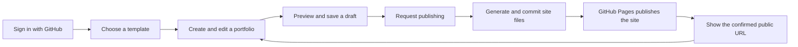
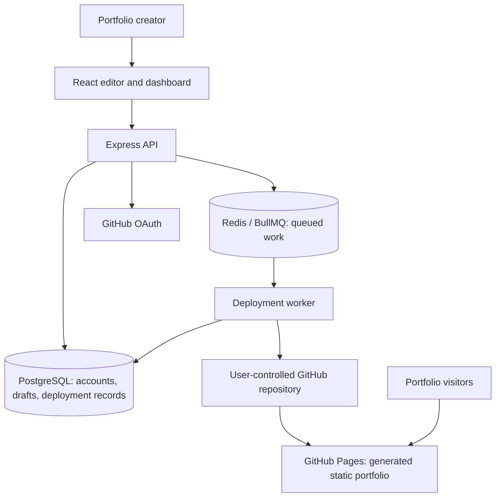

# GitFolio: Objective, Workflow, and Benefits

Reviewed on November 17, 2026 (Asia/Manila).

This document explains the intended product in plain language and assesses its potential value. It distinguishes implemented code from planned behavior. Technical details and the development checklist live in [ARCHITECTURE.md](ARCHITECTURE.md); installation steps live in [README.md](README.md).

## 1. Objective

GitFolio's primary objective is to help someone with a GitHub account create, update, and publish a personal portfolio through one guided browser workflow, with the generated source stored in a repository they control.

A user should eventually be able to sign in, choose a template, enter their information, preview the result, and publish it without manually coordinating repository creation, file commits, build configuration, and Pages setup. The target is a repeatable publishing process that also makes later content updates straightforward.

The browser-only objective applies to portfolio creators. Developers still configure the application, database, Redis, OAuth registration, and hosting.

### Supporting objectives

| Objective | Intended result |
| --- | --- |
| Reduce setup effort | Users spend more of their time on portfolio content and presentation |
| Preserve control of generated source | Users can inspect, edit, or move the output in their GitHub repository |
| Make updates repeatable | A saved project can be edited and republished through the same workflow |
| Explain deployment progress | Users can see whether a site is waiting, building, publishing, live, or failed |
| Keep publishing costs accessible | Eligible static portfolios can use GitHub Pages; the platform's own operating costs remain separate |
| Protect accounts and drafts | Credentials stay on the backend, and each user's projects are accessible only through authorized operations |

These are product objectives, not claims that the complete workflow is already available.

## 2. Intended users

| User group | Likely benefit | Fit and limitations |
| --- | --- | --- |
| Students and graduates | A guided way to publish projects, education, and contact information | Strong potential if GitHub account setup and sign-in are easy to understand |
| Early-career developers and designers | Faster initial publishing and simpler project updates | Templates must support useful customization and accessible layouts |
| Freelancers with a basic showcase | A repository-backed portfolio and a repeatable update process | Suitable for static examples and links; applications needing server features need separate services |
| Experienced developers | Less repetitive repository and publishing setup | Value is smaller if they already have a preferred template and deployment process |
| Maintainers of GitFolio | Practice integrating a complete product across UI, API, database, OAuth, and background jobs | The integration and security work is substantial; the current foundation is only a starting point |

This audience assessment is a product judgment based on the proposed workflow. No user research, adoption figures, or employment outcomes have been validated.

## 3. Current implementation

The repository contains the technical foundation, authentication, and project-management implementation:

- An npm workspace monorepo with React/Vite, Express/TypeScript, and a shared types/validation package.
- A Prisma schema and initial migration for users, templates, projects, sections, and deployments.
- An Express bootstrap with safe errors, security headers, CORS, rate limiting, request IDs, and restricted request logging.
- PostgreSQL and Redis connection code, startup cleanup, shutdown handling, and health/readiness endpoints.
- Docker Compose configuration for local PostgreSQL and Redis, plus setup instructions and development/check commands.
- Server-side OAuth settings, callback validation, initial sign-in scopes, secret redaction, and a configuration checker.

The frontend has GitHub login/callback pages, a connected-account page, AuthGuard, a project dashboard, and a template picker/setup form. The backend implements one-time state, PKCE, encrypted token storage/refresh, revocable JWT sessions, owner-scoped project CRUD, and four seeded templates. Real GitHub consent remains a separate verification step. The editor, generated portfolio files, GitHub publishing, and deployment progress screens remain planned.

Users can create and manage portfolio drafts with copied template themes and sections. Editing those sections and publishing a live portfolio remain later phases.

## 4. Planned user workflow

The following journey describes the target experience after the remaining phases are implemented.

### Step 1: Sign in

The user selects Sign in with GitHub and authorizes GitFolio on GitHub's website. GitHub returns an authorization code to GitFolio's callback. The backend must validate the sign-in request, exchange the code, confirm the user's identity, protect stored GitHub tokens, and issue a GitFolio session.

The GitHub token authorizes GitHub API operations; the GitFolio JWT authorizes requests to GitFolio's API. The OAuth client secret stays on the backend. State, PKCE, token expiration, refresh handling, and the client flow are implemented; a real consent round trip still requires registered credentials. [GitHub OAuth flow](https://docs.github.com/en/apps/oauth-apps/building-oauth-apps/authorizing-oauth-apps).

### Step 2: Create a project

The user selects a template and enters a project name. GitFolio will create an owner-linked project with a theme, sections, and a draft status. A template supplies starting structure and appearance; the saved project stores that user's content and choices.

### Step 3: Edit and preview

The planned editor will support changing section content and order, visibility, colors, fonts, and other supported settings. A preview should reflect those changes. Saving a draft updates GitFolio's database; it does not publish every edit immediately.

Input validation, safe HTML generation, loading feedback, and protection against losing unsaved work are required parts of this experience. Undo/redo and project revision rollback are later features; the current schema has no revision-history model.

### Step 4: Request publishing

The backend will verify that the signed-in user owns the project, validate the publishable data, check the required GitHub permission, record a deployment attempt, and enqueue work. Queue processing lets the UI track progress without keeping one HTTP request open for the entire build and publishing process.

The initial sign-in configuration requests profile and email access. Repository and workflow access must be added through an explicit authorization step when deployment features need them.

### Step 5: Generate and publish files

The worker will generate static HTML/CSS/JavaScript or a React project's source and build workflow, create or update the chosen repository in the user's GitHub account, commit the output, and configure publishing. Project-site paths such as `/my-portfolio/` must be handled correctly so links and assets work after publication.

The intended deployment states are `PENDING → BUILDING → PUSHING → DEPLOYING → LIVE`, with `FAILED` available when an attempt cannot complete. The constants and database enum already exist; the worker transitions do not.

GitFolio should confirm successful publication before showing a deployment as live. If a build or API operation fails, the user should receive a safe explanation and a controlled retry path. Retrying must preserve the saved project and avoid duplicate repositories or conflicting writes.

### Step 6: Share and update

The user shares the confirmed portfolio URL. Later edits can be saved as drafts and republished to the same repository. GitHub commits provide history of published source; restoring editor drafts or structured project versions needs its own implementation.

## 5. Components and responsibilities

This is the planned integration between components. Feature connections beyond the foundation are still to be built.

| Component | Responsibility | Current state |
| --- | --- | --- |
| React client | Forms, dashboard, editing, previews, progress | Login/account, AuthGuard, dashboard, and new-project workflow implemented; editor/publishing screens planned |
| Express API | Validate requests, enforce ownership, save drafts, coordinate publishing | Middleware, health, auth, project CRUD, and seeded template routes implemented; publishing planned |
| PostgreSQL / Prisma | Persist account links, content, templates, and deployment records | Schema/migration and connection code implemented |
| Redis | OAuth state, session revocation, queued background work | Auth state/sessions and connection/ping implemented; queue planned |
| BullMQ worker | Generate files, call GitHub, and update deployment progress | Planned |
| GitHub OAuth and API | Sign-in authorization and repository operations | OAuth code implemented; registration/live consent pending; repository operations planned |
| GitHub Pages | Serve the published static portfolio | Intended destination; no publishing integration verified |

PostgreSQL can run locally or use a compatible hosted service such as Supabase. A hosted database changes where data is stored; GitFolio still needs its API, worker, and Redis services. A Supabase connection has not been verified as part of this implementation.

## 6. Benefit analysis

### Expected user benefits

| Benefit | Why it could matter | What must work for the benefit to be real |
| --- | --- | --- |
| Less repetitive setup | One workflow can coordinate content, repository creation, and publication | Reliable end-to-end publishing with understandable errors |
| Easier maintenance | Users can update a saved portfolio instead of reconstructing the process each time | Draft persistence, clear save/publish behavior, and safe retries |
| Control over generated code | A user-controlled repository makes inspection and moving the output practical | Readable, complete output and clear template/asset licensing |
| More predictable presentation | Templates can provide a consistent starting structure | Responsive, accessible templates and enough useful customization |
| Clearer failure recovery | Progress and deployment history can explain where publishing stopped | Accurate status transitions, sanitized logs, and idempotent retries |
| Accessible portfolio hosting | Eligible public repositories can use GitHub Pages on GitHub Free | Compliance with GitHub plan, content, and usage requirements |

GitHub Pages serves static files and supports eligible public repositories on GitHub Free. Private-repository availability depends on the plan. The generated portfolio is the Pages-hosted output; GitFolio's API, database, Redis, worker, and any optional domain still have separate operating needs and potential costs. [GitHub Pages documentation](https://docs.github.com/en/pages/getting-started-with-github-pages/what-is-github-pages).

The generated source can remain under the user's control. GitFolio's saved draft data, editor behavior, and account settings also need an export/recovery design to provide a complete exit path; source in a repository alone does not deliver that feature.

### Product and engineering value

For a portfolio creator, the strongest likely benefit is a shorter, clearer path from prepared content to a published site. For an experienced developer who already has a working publishing workflow, the added value may be smaller.

GitHub already provides browser-based repository tools and reusable templates. GitFolio's proposed advantage is combining content editing, validation, preview, publishing, and progress into one coherent experience. The result must be easier to use and maintain than the manual process to justify an additional platform.

For the development project, the existing workspace structure, shared contracts, schema constraints, and safe server bootstrap provide a useful base for implementing the remaining features. Running a queue and database also introduces operating work. Their value depends on reliable asynchronous publishing and persistent editing.

There is a plausible product opportunity around useful templates and dependable publishing. User demand, willingness to pay, support effort, and the ability to cover platform costs have not been validated. No revenue or hiring benefit should be assumed from the architecture alone.

## 7. Limitations and tradeoffs

| Limitation | Practical implication |
| --- | --- |
| GitHub account requirement | Users must understand account authorization and keep access to the owning account |
| Static hosting destination | Dynamic server features need separate services; generated output must build into static assets |
| GitHub availability and API limits | Publishing can be delayed or fail; the worker must respect rate limits and retry safely |
| OAuth permission and token handling | Revocation, expiration, refresh, encryption, and ownership checks require careful implementation |
| Separate platform costs | Low-cost portfolio hosting does not remove API, database, Redis, worker, monitoring, or support costs |
| Generated output and draft data have different recovery paths | Repository source is useful, but draft exports and revision restoration are separate product features |
| Template constraints | A guided editor cannot automatically support every custom application or design |
| Current implementation is incomplete | The user benefits remain expected outcomes until sign-in, editing, and publishing work together |

GitHub Pages has hosting limits and restrictions on commercial transaction/SaaS uses. GitFolio's service itself needs separate hosting; generated sites must stay within the permitted use and applicable quotas. This should be checked before promising unlimited publishing or hosting. [GitHub Pages limits](https://docs.github.com/en/pages/getting-started-with-github-pages/github-pages-limits).

The worker also needs to account for GitHub's primary and secondary API limits and expose temporary failures without leaking credentials. [GitHub REST API limits](https://docs.github.com/en/rest/using-the-rest-api/rate-limits-for-the-rest-api).

Security and reliability directly affect the user benefits. A portfolio builder that overwrites unrelated repository files, exposes tokens, or reports failed deployments as live would undermine its main purpose.

## 8. Success measures

Start with a small user trial and compare against the same people completing a manual portfolio publishing task. Record a baseline before setting improvement targets.

| Measure | What to record |
| --- | --- |
| First successful publication | Time from starting sign-in to opening the confirmed live URL |
| Completion rate | Users who finish the publishing task, including where others stop |
| Update effort | Time and number of actions needed to change and republish existing content |
| Publishing reliability | Successful attempts, failure causes, time to recover, and duplicate/unsafe writes |
| Output quality | Responsive layout, accessibility checks, working assets and links, and export completeness |
| Support burden | Cases requiring developer assistance, including OAuth setup and permission explanations |
| Operating cost | Actual infrastructure/build/support expense relative to active users and successful publishes |

Set release targets after the baseline is observed. Phase 1 tests validate foundation behavior; they do not establish product usability, demand, or a production publishing success rate.

## 9. First release recommendation

1. Finish OAuth registration and the full sign-in/session flow, including required token protections.
2. Implement owner-scoped project CRUD and one well-tested static template.
3. Build a focused form-based editor with clear draft saving and an accurate preview.
4. Deliver and verify a complete publish/update/retry workflow to a public repository.
5. Test the result with portfolio creators, collect the measures above, and improve the points where they need help.
6. Expand to React templates and additional customization after the simpler publishing path is reliable.

This release recommendation prioritizes proving the product's central benefit with a small, reliable workflow.

## 10. Assessment

GitFolio has strong potential as a guided portfolio publishing tool for people who want a site backed by a repository they control. Its value would come from reducing repeated setup and making future updates and failures easier to handle.

The current repository provides a foundation for that product, but the main user journey is still planned. The most convincing evidence of benefit will be users successfully creating, publishing, updating, and recovering their portfolios with less effort than their existing approach.
